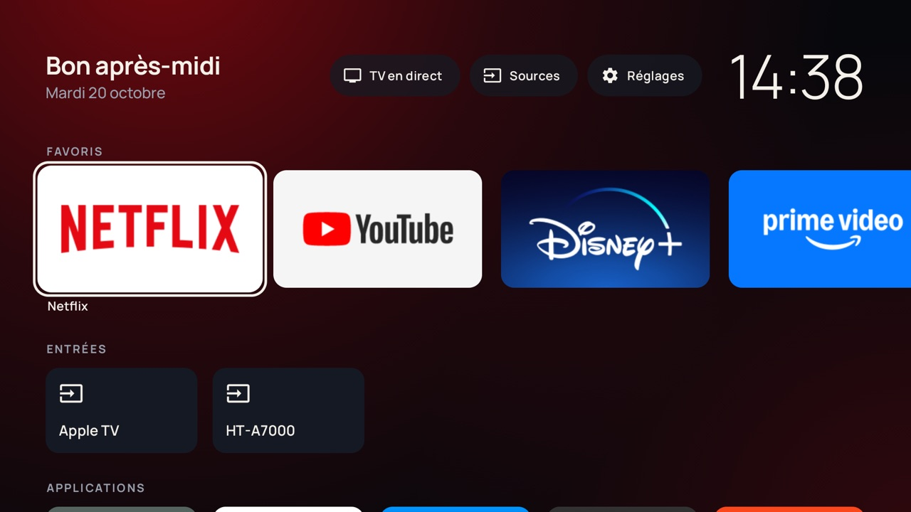
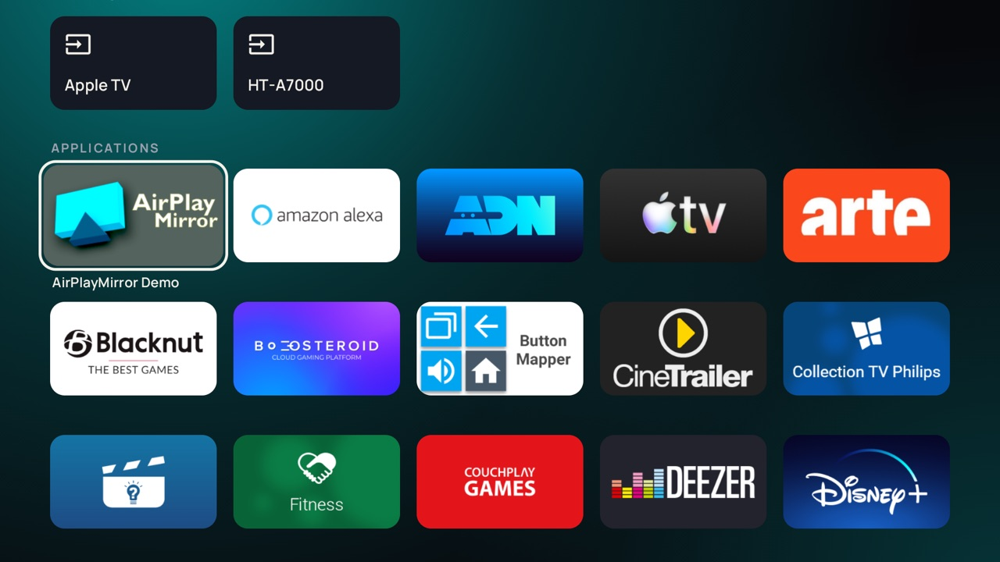
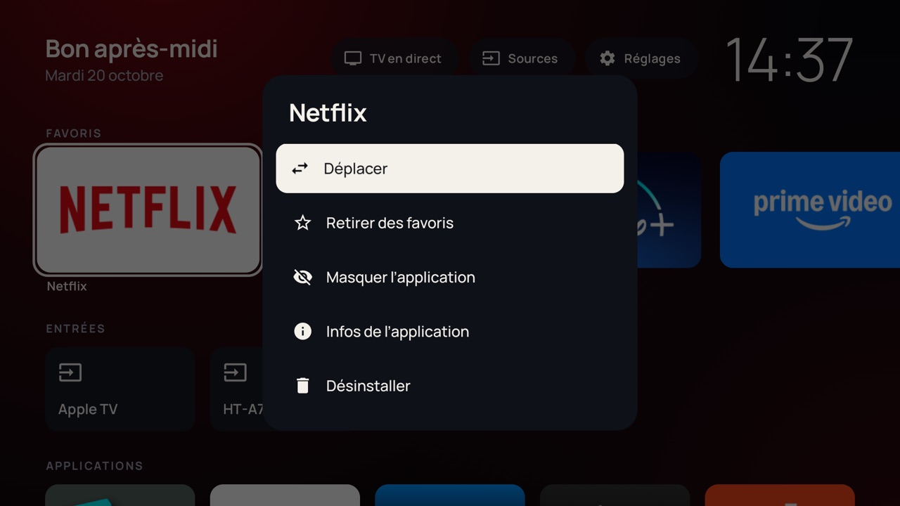
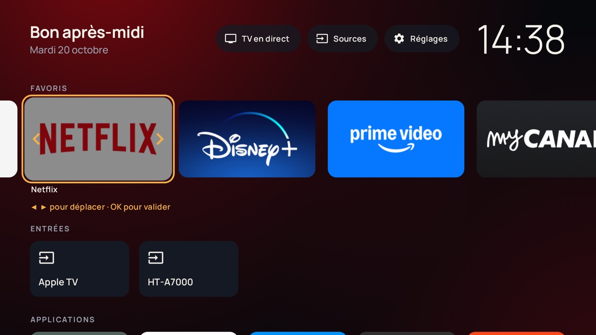

# tv-launcher

A custom home screen (launcher) for the living-room Android TV: dark, quiet and fast,
built around the apps' own artwork and the remote's D-pad.



| Apps & inputs | Long-press menu | Reordering favorites |
|---|---|---|
|  |  |  |

## Features

- **Favorites row**: large banners, pre-filled on first run with the streaming apps that are installed.
- **Inputs row**: HDMI devices that are actually plugged in, listed by their HDMI-CEC name (e.g. "Apple TV"), opened in one click.
- **All apps** grid, alphabetical, updated live when an app is installed or removed.
- **Quick actions** in the header: Live TV, Sources, Settings (one press up from the favorites).
- **Long-press any app**: add to / remove from favorites, move (◀ ▶ then OK), hide, app info, uninstall.
  Hidden apps stay reachable from the last tile of the grid.
- **Ambient background** tinted by the focused app's artwork.
- Back and Home always return to the first favorite: the launcher can never be "exited".

## Target device

| | |
|---|---|
| Model | Philips 58PUS7304/12 |
| OS | Android TV 12 (build `STT2.230526.001`, security patch 2025-11-01) |
| SoC / RAM | MediaTek MT5887 (armv7), 2 GB |
| UI | 1920x1080 @ 320 dpi (960x540 dp) |
| Access | ADB over the local network (`192.168.0.240:5555`, override with `TV_ADDR`) |

Measured on the TV (v0.1.x): cold start ~1.0 s (`am start -W`), ~56 MB PSS, 2 MB APK.

## Requirements

- JDK 21 (`brew install --cask temurin@21`)
- Android SDK with platform 37 (`sdk.dir` in `local.properties`, or `ANDROID_HOME`)
- `adb`, and `gh` for releases

## Everyday commands

```bash
scripts/install.sh            # build, install and AOT-compile on the TV
scripts/set-home.sh           # make tv-launcher the HOME app (Home button)
scripts/screenshot.sh         # PNG of the TV screen into captures/
scripts/rollback.sh           # stock Google launcher back as HOME
```

Unit tests: `./gradlew testDebugUnitTest`.

## Rollback

Nothing on the TV is replaced or uninstalled: tv-launcher is a separate app and the stock
launcher is only *disabled*, which is fully reversible.

| Goal | Command |
|---|---|
| Back to the stock Google TV launcher (keep tv-launcher installed) | `scripts/rollback.sh` |
| Back to stock and remove tv-launcher | `scripts/rollback.sh --uninstall` |
| Go back to an older tv-launcher release | `scripts/rollback.sh --version v0.1.0` |
| Install any local APK | `scripts/install.sh path/to/app.apk` |

Installing an *older* version than the one on the TV requires an uninstall first (Android
refuses downgrades of release builds), so favorites and hidden apps reset in that case.

Without a computer: Settings → Apps → *See all apps* → *Show system apps* →
**Android TV Home** (*Accueil d'Android TV* in French) → *Enable*, then press Home.

### Why the stock launcher is disabled

The stock launcher is a system app whose HOME intent filter has priority 2. Android always
resolves HOME to a strictly higher-priority match before looking at the user's preferred
app, so `cmd package set-home-activity` alone has no effect on this TV.
`scripts/set-home.sh` therefore runs `pm disable-user --user 0 com.google.android.tvlauncher`,
and `scripts/rollback.sh` runs `pm enable` to undo it.

## Releases

Every release is a git tag plus a GitHub release with the signed APK attached, so any
version can be reinstalled later (`scripts/rollback.sh --version vX.Y.Z`).

1. Bump `versionName` in `app/build.gradle.kts` (`versionCode` is derived from it).
2. Commit and push.
3. `scripts/release.sh`

The release keystore (`keystore/release.jks`) is committed on purpose in this private
repository: every build, from any clone or tag, carries the same signature and can be
installed over another. Do not make the repository public without rotating it.

## Project layout

```
app/src/main/kotlin/dev/johan/tvlauncher/
├── MainActivity.kt          single activity, HOME + launcher entry point
├── LauncherApp.kt           manual dependency container, memory trimming
├── data/                    app discovery, HDMI inputs, DataStore settings, pure home logic
├── image/ArtworkCache.kt    banner rasterisation + accent colors, LRU bounded by bytes
└── ui/
    ├── theme/               design tokens and Manrope typography
    ├── components/          cards, quick actions, header, menus, ambient background
    └── home/                home screen, view model, intents
scripts/                     install / set-home / rollback / screenshot / release
```

Stack: Kotlin, Jetpack Compose for TV (`androidx.tv:tv-material`), coroutines + Flow,
DataStore. AGP 9.4, Gradle 9.8, minSdk 28, R8 enabled.

## Credits

Manrope typeface by Mikhail Sharanda, SIL Open Font License 1.1.
